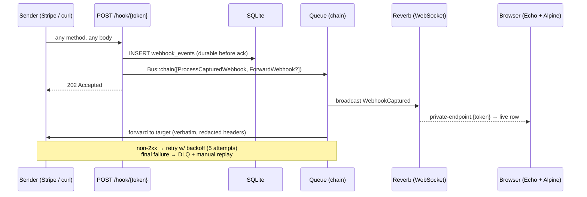

# webhook-inspector

A self-hosted webhook inspection tool: point any sender (Stripe, GitHub, PayPal, curl…) at a capture URL, watch requests arrive **live**, inspect headers/bodies, and replay or forward them with retries and a dead-letter queue.

Built as a portfolio piece demonstrating a production-shaped Laravel slice: **queues + job chaining, broadcasting (Reverb), authorization (policies + private channels), rate limiting, at-least-once delivery semantics, and a tested ingest path**.

## Architecture



### Design decisions worth reading the code for

| Decision | Where | Why |
|---|---|---|
| Persist **before** acking 202 | `WebhookCaptureController` | A 202 tells the sender to stop retrying — the payload must already be durable. Queue-only capture loses webhooks silently if a job is lost. |
| Broadcast + forward via `Bus::chain` | controller → jobs | Forward can never race ahead of the persisted event, even with parallel workers. |
| Target URL used **verbatim** on forward (query string preserved) | `ForwardWebhook::targetUri()` | Surprise-path-appending breaks downstream routers; path-style targets opt in via trailing slash. |
| Credential headers redacted on forward | `config/webhook-inspector.php` | Replaying a captured `Authorization` header to a third-party host is a credential leak. |
| At-least-once delivery, documented | `ForwardWebhook` | Receivers must dedupe; the original headers (incl. `Idempotency-Key`) are forwarded unchanged. |
| Compact broadcast payloads | `WebhookCaptured::broadcastWith()` | WS fan-out carries the row id; clients fetch bodies on expand. |
| Private per-endpoint channels | `routes/channels.php` | Only the owner may listen; enforced server-side by token ownership. |

## Stack

Laravel 12 · Reverb (broadcasting) · database queue · SQLite · Blade + Alpine + Tailwind · Pest

## Local setup

```bash
composer install && npm install && npm run build
php artisan migrate
```

Run the four processes (dev):

```bash
php artisan serve                      # app
php artisan queue:work                 # broadcast + forwarding
php artisan reverb:start               # websockets
npm run dev                            # vite
```

Then: register → create an endpoint → fire:

```bash
curl -X POST 'http://localhost:8000/hook/<token>' \
  -H 'Content-Type: application/json' \
  -d '{"order_id":42,"status":"paid"}'
```

The event appears in the dashboard in realtime. Configure a forward target and failures will climb the retry ladder (5s → 15s → 60s → 5m → 15m) into the DLQ, where you can replay them.

## Operations notes

- Retention: `webhooks:prune` (scheduled daily 03:17) drops events older than `WEBHOOK_RETENTION_DAYS` (default 7).
- Body cap: `WEBHOOK_MAX_BODY_BYTES` (default 1 MiB) — enforced pre-queue with 413.
- Rate limit: 120 req/min per IP+endpoint (`webhook-capture` limiter) → 429.
- In production, tune the webserver's body-size limit to match the app cap, and run the queue worker + Reverb under a supervisor.

## Tests

```bash
php artisan test
```

46 tests / ~100 assertions covering: ingest durability + 202 contract, capture fidelity (raw bodies, query strings, headers), forwarding verbatim + redaction, retry → DLQ transitions, replay authorization, private-channel auth (owner vs stranger), rate limiting, size caps, retention pruning.
